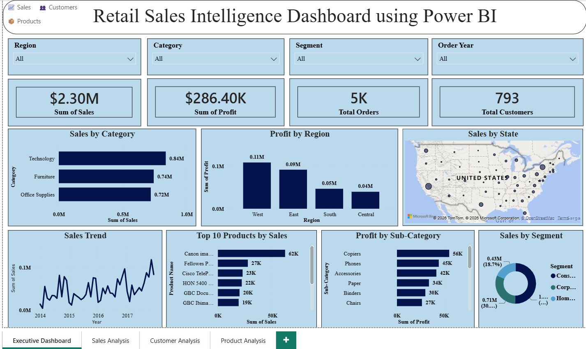
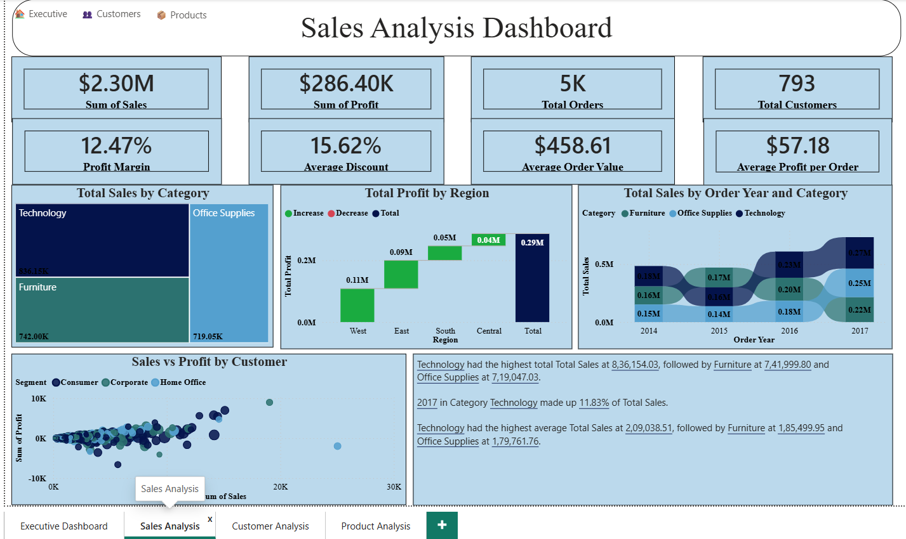
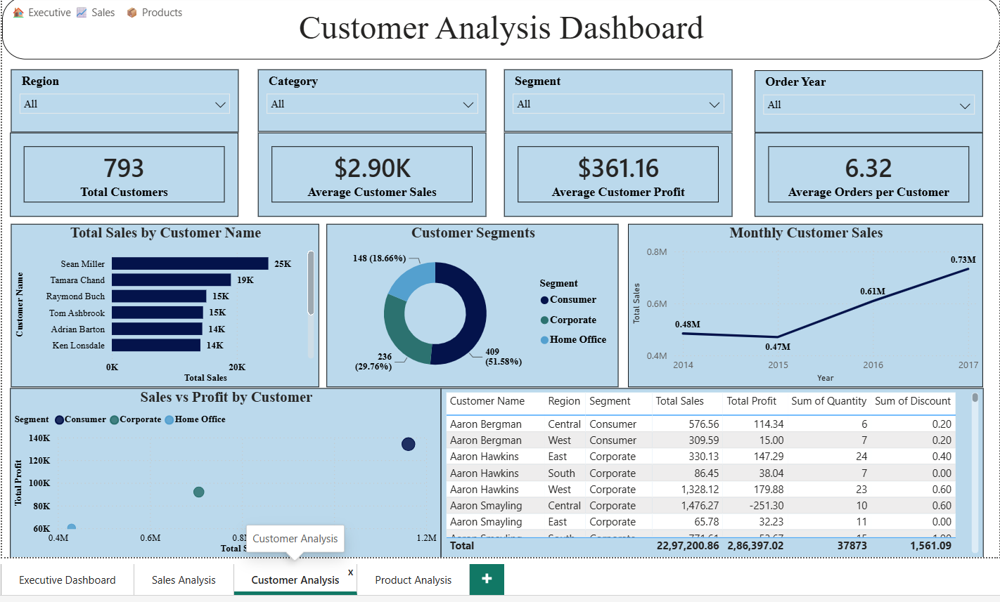
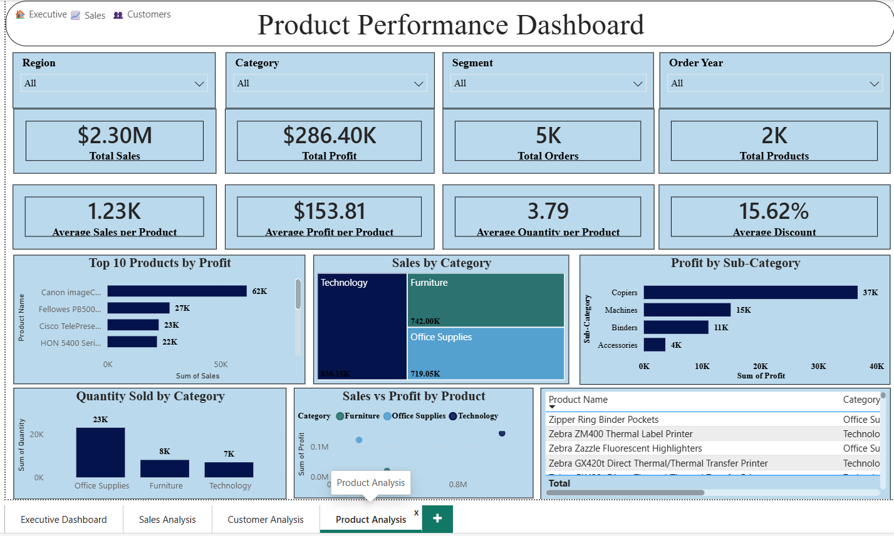

# 📊 Retail Intelligence Platform

An end-to-end retail analytics platform built on the Superstore dataset: 7 interactive Streamlit dashboards covering sales, customers and products, plus three analytics modules for forecasting, customer segmentation and product recommendations.


**🔗 Live app:** [retail-intelligence-platform on Streamlit Cloud](https://retail-intelligence-platform-zqqszwmtvckeddmawuhcgr.streamlit.app)

---

## Dashboard Preview

The screenshots below are from the **Power BI companion dashboard** (`powerbi/`), which covers the same four descriptive areas as the Streamlit app. The Streamlit app is live at the link above.

### Executive Dashboard



### Sales Analysis



### Customer Analysis



### Product Analysis



---

## 📊 Dataset at a Glance

| Metric | Value |
|---|---|
| Order line items (rows) | 9,994 |
| Unique orders | 5,009 |
| Date range | Jan 2014 – Dec 2017 |
| Total Sales | $2.30M |
| Total Profit | $286.4K |
| Unique Customers | 793 |
| Unique Products (Product ID) | 1,862 |
| Categories | Furniture, Office Supplies, Technology |
| Regions | South, West, Central, East |

---

## 🏗️ Architecture

```
Raw CSV (SampleSuperstore.csv)
        │
        ▼
Data Cleaning & Feature Engineering  (notebooks/01, 03)
        │
        ▼
data/processed/processed_superstore.csv
        │
        ▼
SQLite Database (database/retail.db)   ← src/database/import_data.py
        │
        ▼
Streamlit Multi-Page Dashboard  (src/dashboard/)
        │
        ├── Executive / Sales / Customer / Product Analysis  (descriptive)
        ├── Sales Forecasting          → seasonal forecast with backtest
        ├── Customer Segmentation      → K-Means clustering
        └── Product Recommendation     → rule-based scoring engine
```

All 7 dashboard pages read from the same SQLite database via a shared connection helper (`src/database/db_connection.py`), so the whole platform stays in sync from a single source of truth.

---

## ✨ Features

| # | Dashboard | What it does |
|---|---|---|
| 1 | **Executive Dashboard** | High-level KPIs, state map and trends across the whole business |
| 2 | **Sales Analysis** | Sales performance by region, state, category and time |
| 3 | **Customer Analysis** | Customer-level behavior, repeat-customer rate and value breakdown |
| 4 | **Product Analysis** | Product and sub-category performance |
| 5 | **Sales Forecasting** | 12-month seasonal sales forecast with a backtested accuracy KPI |
| 6 | **Customer Segmentation** | K-Means clustering into Low Value / Regular / High Value customer tiers |
| 7 | **Product Recommendation** | Rule-based scoring engine that ranks and recommends products |

### Analytics Modules

**Sales Forecasting**: aggregates historical sales into a monthly series and forecasts the next 12 months. Each future month is the same month last year, scaled by the latest year-over-year growth, so the forecast keeps the strong Q4 seasonality in the data (September, November and December account for about 43% of annual sales). A **Forecast Accuracy** KPI backtests the method by holding out the last 12 months and reporting 100 − WAPE (about 76% on the full dataset; smaller filtered slices score lower and the app shows that honestly). An earlier 3-month moving average was replaced because it flattened the forecast and scored far worse in the same backtest.

**Customer Segmentation**: aggregates each customer's total Sales, Profit and Order count, standardizes the features (`StandardScaler`), and clusters them with `KMeans(n_clusters=3)`. Clusters are ranked by average sales and mapped to human-readable tiers (🔴 Low Value / 🟠 Regular / 🟢 High Value) rather than raw cluster numbers, so the labels stay meaningful across re-runs. Three clusters were chosen for business interpretability; the silhouette score is about 0.38.

**Product Recommendation**: a transparent, rule-based alternative to a black-box recommender. Each product's Sales, Profit, Orders and Discount are min-max normalized and combined into a weighted score (`0.35×Sales + 0.35×Profit + 0.20×Orders − 0.10×Discount`), rescaled to 0–100. The top 30% of products by score are flagged as **Recommended**. A **Demand Alignment** KPI reports what share of recommended products are also flagged High Demand (top quartile by orders). Because Orders is part of the score, this is a consistency check, not a measure of predictive accuracy.

---

## ⚠️ Notes and Limitations

- The dataset covers only four years, so the forecast rests on three years of year-over-year history and its accuracy is moderate.
- "Repeat Customer Rate" counts customers with more than one order inside the current filters. It is not a true retention measure.
- `sql/03_insert_data.sql` uses MySQL syntax; the SQLite database is built with `src/database/import_data.py` instead.

---

## 🛠️ Tech Stack

- **Language:** Python 3.12
- **Dashboard:** Streamlit + Plotly
- **Machine Learning:** scikit-learn (K-Means, StandardScaler)
- **Database:** SQLite
- **Data Prep:** pandas, numpy, Jupyter notebooks
- **BI Tool:** Power BI (`powerbi/`)

---

## 🚀 Getting Started

### 1. Clone and install dependencies

```bash
git clone https://github.com/RaipallyArjun/Retail-Intelligence-Platform.git
cd Retail-Intelligence-Platform
pip install -r requirements.txt
```

### 2. (Optional) Rebuild the database

`database/retail.db` is included, so you can skip this step. To rebuild it from `data/processed/processed_superstore.csv`, run:

```bash
python src/database/import_data.py
```

This also recreates the audit table, views, trigger and indexes from the `sql/` folder.

### 3. Run the dashboard

```bash
streamlit run src/dashboard/app.py
```

The app opens at `http://localhost:8501` with all 7 pages in the sidebar.

---

## 📁 Project Structure

```
Retail-Intelligence-Platform/
├── data/
│   ├── raw/                    # Original Superstore CSV
│   ├── cleaned/                # After the data-cleaning notebook
│   └── processed/              # Feature-engineered CSV loaded into SQLite
├── database/
│   └── retail.db               # SQLite database (built from the processed CSV)
├── notebooks/
│   ├── 01_Data_Cleaning.ipynb
│   ├── 02_EDA.ipynb
│   ├── 03_Feature_Engineering.ipynb
│   ├── 04_Sales_Forecasting.ipynb
│   └── 05_Customer_Segmentation.ipynb
├── sql/                        # Schema, queries, views, triggers, indexes
├── src/
│   ├── dashboard/
│   │   ├── app.py              # Streamlit entry point
│   │   └── pages/              # 7 dashboard pages
│   └── database/
│       ├── db_connection.py    # Shared SQLite connection helper
│       ├── import_data.py      # Loads processed CSV into SQLite
│       └── us_states.py        # State name → two-letter code (for the maps)
├── powerbi/                    # Power BI companion dashboard
├── reports/                    # Final_Report.pdf, Presentation.pptx
├── images/                     # Power BI dashboard screenshots
└── requirements.txt
```

---

## 📄 Reports

- [`reports/Final_Report.pdf`](reports/Final_Report.pdf): written analysis covering methodology, EDA findings, the analytics approach and business recommendations
- [`reports/Presentation.pptx`](reports/Presentation.pptx): condensed slide deck for a stakeholder audience

---

## 🔭 Future Improvements

- Compare the seasonal forecast with Prophet or SARIMA using the same backtest
- Extend the recommendation engine with collaborative filtering alongside the rule-based score
- Add automated data-quality checks to the ingestion pipeline
- Add Streamlit screenshots to the preview section